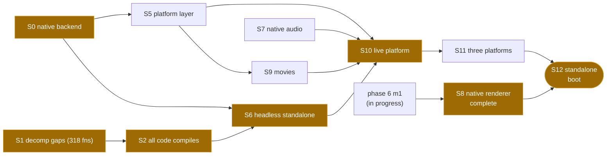

# Standalone: Burnout 3 as one native executable, no emulation (plan, 2026-11-02)

Goal (firm): no emulation in the end result, a native PC port. The milestone this document
plans is the first build that runs as **one native executable** on Windows x86-64, macOS (Apple Silicon) and Linux,
with **no** EE/VU/IOP/GS/SPU2/IPU emulation and **no** recompiled or interpreted guest code.
Desk plan, offline only: nothing was run. Tags: **[C]** confirmed from a cited artefact, **[L]** likely, **[G]** guess.

Sources: this repo at 67bd679 (README, `decomp-on-host.md`, `native-renderer.md`,
`frame-rate.md`, `docs/status.json`, `gen/decomp/manifest.tsv`); decomp HEAD 8e81b8b0f9 (read only:
the decomp's `docs/port-libraries.md`, `research/port/game_library_calls.tsv`, `config/proven_units.txt`, `assembly/asm/**`,
`research/retail_names.csv`, `research/E_classified.csv`, `tools/progress_stats.py`, `tools/progress_report.py`);
the installed disc tree `%B3_WIN%\perf\install\game`
(file names and sizes only; two IRX files scanned for one constant).

## 0. Summary

| | |
|---|---|
| **What "standalone" means** | One process: decomp game code compiled natively (as today, through `decomp2host`) + our own replacements for every library and hardware service below it + SDL3 platform layer + the native renderer. The retail ELF is still read at start-up, but only as **data**: its `.data`/`.rodata` image is loaded into the 32-bit arena (vtables, tables, float constants), the way the disc's assets are loaded. No instruction of it is executed. |
| **What counts as emulation (not allowed)** | Instruction interpreters or recompilers (EE, VU0 micro, VU1, IOP R3000); hardware register / DMA / memory-map models (GS, VIF/GIF, DMAC, SIF, SPU2 registers and SPU2 RAM, IPU); IOP modules running as code. |
| **What stays and is not emulation** | Numeric models of the PS2's arithmetic as plain native code where gameplay depends on it: PS2 floats (`b3fp`, MXCSR/FPCR), VU0 FMAC rounding in GtMathPs2's faithful mode, b3libm, and the sound DSP (PS-ADPCM decode, ADSR, Gaussian resampling, saturated mixing) as a native mixer with voices as objects, no register file. These define what the game *is*, the same way the physics code does. |
| **Biggest single dependency** | The fully native renderer (phase 6 all the way to "GS fallback off"): 7-9 work-months [G, `native-renderer.md` §7.2]. Everything else fits beside it. |
| **Decomp gap found** | **318 Criterion functions (74.9 KB) have no C and are not in the decomp's game-code count** [C, §1.1]: 166 under `assembly/asm/d2`-`d6` (the boot code, **the per-frame main loop `func_00132600`**, stage `Prepare`/`Update`, front-end flow, `CGTFileSystem`, the memory manager, pools, `vdb` tuning variables, vehicle init/collision/transmission) and 152 static initialisers (`sinit*.s`). The README's "100% complete C" is true for the 5,330 counted functions only. |
| **Rough calendar** | 6-9 months to a standalone boot with 3 lanes in parallel, gated by the renderer [G, §5]. |

## 1. Inventory: everything the game needs from below

Counts of library functions are the decomp's direct-`jal` scan (`research/port/game_library_calls.tsv`: 414 of the
3,451 library functions are called directly from game code [C]; it misses calls through function pointers and RW
macros, the decomp's `port-libraries.md` §1). Library sizes are the `nonmatching <name>, <size>` lines of `assembly/asm/<lib>/*.s`
[C, scratch script]. Size guesses for our replacements are lines of new native code and work-weeks [G].

Column "exact?": **exact** = game-visible, must reproduce retail behaviour bit for bit (it feeds simulation state, saves
or the sequence of game decisions); **output-exact** = what the player hears or sees must match retail's output but may
differ in timing below one tick / in sample alignment; **free** = presentation, may differ (and is where the remaster
improves things).

### 1.1 Game code (Criterion's own, from the decomp)

Totals [C `docs/status.json` `decomp_fallback`, `gen/decomp/manifest.tsv`, port8 results]: **5,330 functions, 2.63 MB**;
4,487 byte-matched (1.31 MB) + 843 complete C (1.32 MB), 0 partial. On the host today: **1,033 generated** (845
matched + 188 drafts), 799 of 946 discovered functions pass the offline checker (port8 check3). Non-leaf generation: 2,321 of 3,444 non-leaf functions with source
generate and compile (port7); VU0 leaves 115 of 119 (port6/7) [C].

By area [L: each function's subsystem from `research/E_classified.csv` through the E-map object file named in
`research/retail_names.csv`; 2,531 of 5,321 scanned functions are named directly, the rest take the nearest named
neighbour's subsystem (files are contiguous address ranges)]:

| Area | Functions | byte-matched | complete C (non-matching) | Code | share non-matching (bytes) | generated for the host today |
|---|---:|---:|---:|---:|---:|---:|
| Traffic + rival AI | 289 | 208 | 81 | 361 KB | 51% | 131 |
| Vehicle physics + collision | 417 | 264 | 153 | 334 KB | 75% | 93 |
| Crashes, takedowns, scoring, race modes, replay | 883 | 774 | 109 | 310 KB | 47% | 137 |
| HUD + 2D (Gt2d) | 583 | 466 | 117 | 295 KB | 54% | 49 |
| Rendering (scene, effects, post) | 472 | 337 | 135 | 238 KB | 68% | 129 |
| Saves, assets, input, core, debug | 782 | 718 | 64 | 227 KB | 37% | 165 |
| Front end (menus) | 401 | 376 | 25 | 223 KB | 17% | 40 |
| Sound (game side: `CB3Sound*`, `CGtSound*`) | 634 | 579 | 55 | 213 KB | 30% | 195 |
| Camera | 185 | 125 | 60 | 152 KB | 82% | 45 |
| Online / network (game side) | 466 | 443 | 23 | 119 KB | 23% | 25 |
| Online / network (EA/Sony libraries linked inside the game range: `libSharedLogin`, `ezNetCnf`, `libmrpc`, ...) | 209 | 187 | 22 | 65 KB | 29% | 24 |
| **Total** | **5,321** | **4,477** | **844** | **2.54 MB** | | **1,033** |

(5,321 / 2.54 MB rather than 5,330 / 2.63 MB: the scan keys functions by name, so a few duplicate names collapse, and
it sums the asm `nonmatching` sizes; the status counters are the authority for totals.)

Two things this table says: the non-matching (complete C, not byte-proven) code sits exactly where gameplay lives
(physics 75%, camera 82%, traffic/AI 51% of the bytes), so for those functions **a differential proof against retail is
the only proof** of equivalence; and the host side has generated about a fifth of the game so far.

**Not in that count, no C at all** [C: no proven unit covers their addresses, no `src/nonmatching` archive, no `src`
file names the address; `tools/progress_report.py`'s docstring classes `d2-d6/` and `sinit.s` as "third-party
middleware or compiler-generated glue"]:

| Where (decomp asm) | Functions | Bytes | What it is |
|---|---:|---:|---|
| `d5/` (`boot.s`, `unit_00131D20.s`, `unit_00131AC0.s`, `frontend_flow.s`, `play_mode.s`, `play_transition.s`, `mode_base.s`, `network_mode.s`, `preview_*.s`) | 55 | 18,332 | **the game's spine**: boot (0x12EB30, 960 B), `CB3Game::Construct`, the per-frame update `func_00132600` with `UpdatePreSimulation`/`UpdatePostSimulation` (`frame-rate.md` §1), `CB3OnePlayerStage::Update` 0x135180 / `Prepare` 0x135280, front-end flow, game modes |
| `d4/` (`fs.s`, `memmgr.s`, `pool.s`, `ustring.s`, `ustrfmt.s`, `valuedb.s`, `vdb.s`, `gamemode.s`, ...) | 74 | 13,264 | `CGTFileSystem` (FOpen/FRead/FSeek/..., `InstallToRenderWare`), memory manager, pools, Unicode strings and formatting, the value DB and `vdbRegister*` tuning variables, `CB3TwoPlayerSplitScreenStage::Prepare` |
| `d6/` (19 files) | 21 | 5,188 | vehicle init, body parts and state, transmission (init, rpm, update), vehicle collision (filter, query, shape init), register/reset/activate/shutdown, vehicle timer and transform |
| `d2/`, `d3/` (14 files) | 16 | 616 | single functions between known units |
| **d2-d6 total** | **166** | **37,400** | |
| `sinit.s`, `sinit_004D7150.s`, `sinit_004D81D0.s` | **152** | **37,484** | C++ static initialisers of game translation units (0x4D3E00-0x4DD81C) |

These must get C before a native build can boot (the main loop is among them). They are ordinary decomp work for the
non-matching track, ~3-5 work-weeks [G: 75 KB at the drafting rates of the decomp's progress log, 2026-10-31; d5/d6 are
VU-light state machines, the vehicle ones VU-heavy], and they should enter the decomp's counters so the README stops
reading 100%.

**What else the game code needs before it can run natively, independent of the libraries:**

| Item | Today | Standalone needs | Size [G] |
|---|---|---|---|
| Generation coverage (`decomp2host`) | 1,033 generated; non-leaf 2,321 / 3,444 compile | all 5,330 + 318 generate and compile in host mode | 4-6 weeks |
| Inline asm the translator refuses | 1.4% of statements: `vcallms` (24 uses), 16 other mnemonics, labels/branches [C `asm_census.txt`] | `vcallms` sites call C versions of the **2 VU0 microprograms** (0x4787D0 3,648 B for `GtIntersection::IntersectFrustum`, 0x4839E0 1,312 B for `func_001618C0` [C `native-renderer.md` §2.2]); the rest translated or rewritten in the draft | 1-2 weeks |
| Guest-call routing | unported callees have no native version; port12 non-atomic fibers for callees that reach a `syscall` | every call resolves to a native function through one table (guest address -> host function), including vtable slots and function pointers stored in data; an unknown address is a fatal error with the address | in M0 |
| The *PS2.cpp back ends | Criterion's platform files (43 `*PS2*.cpp` objects in the E map, ~400 named functions [C `retail_names.csv` sources]: `GtFileSystemPS2DVD`, `GtThreadMgrPS2`, `GtHiResSystemTimerPS2`, `GtInputDevicePS2DualShock`, `GtVideoDecoderPS2`, `GtTextureCachePS2`, `B3GraphicsManagerPS2`, ~20 renderer `*PS2.cpp`, `B3SoundDistPS2`, `GtPS2LibNet`, `B3MemoryManagerPS2`, ...) | replaced, function by function, by **PC back ends with the same class interface** (the engine was built for that: Criterion shipped Xbox back ends of the same classes). The game-logic front halves stay decomp code | inside the platform, audio and renderer milestones |

### 1.2 Criterion engine libraries (Gt*)

All `CGt*` code (math, 2D, containers, file system, timers, threads, input devices, sound, video, textures) is part of
the game-code count above (`GameShared/GameClasses`), apart from `CGTFileSystem` in `d4/`. Nothing separate to replace
except their `*PS2` back ends (§1.1). GtMathPs2's inline VU0 API already has a host implementation with a fast and a
PS2-faithful mode (`include/gtmath/b3`) [C README "Repository layout"]. **Exact** (physics, collision, cameras use it).
macOS/ARM: a NEON path plus the portable `b3fp::ref` model (README "Built to be portable") [L: not built yet].

### 1.3 RenderWare 3.6 (non-render parts)

RW 3.6 occupies 0x1D8260-0x211C2C, 679 functions, 235 KB [C]. Game code calls 50 RW functions at 182 sites; no
`RpWorld/RpClump/RpAtomic/RpGeometry/RpMatFX/RpSkin/RwIm2D` is linked at all [C `native-renderer.md` §2.1].

| Part | Game use | Native replacement | Exact? | Verified by | Size [G] |
|---|---|---|---|---|---|
| Engine lifecycle (`RwEngineInit/Open/Start/Close/Term`, `RwEngineSetVideoMode`, `RwOsGetMemoryInterface`, `RwFrameSetStaticPluginsSize`, `RwRasterRegisterPlugin`) | boot / shutdown, once | thin shim; plugin registration only as far as it fixes struct sizes the game reads | exact **only in the heap allocations it makes** (see §4.1) | §4 | 300 lines |
| Camera / frame / matrix (`RwCamera*` x ~25 sites, `RwFrame*`, `RwMatrixUpdate`, `RwV3dLength`, `_rwObjectHasFrameSetFrame`) | camera set-up, clip planes, view window | our own small RW object model with the 3.6 field offsets the game reads (the decomp's `port-libraries.md` §3 rule 2); the camera feeds the renderer | exact where game code reads the numbers back (`RwV3dLength`, frame matrices) [L: camera only] | §4 | 800 lines |
| Raster / texture / texture cache (`RwRaster*`, `RpSkyTexCache*` ~25 sites) | `CGtTexture` is an `RwRaster` with the sky2 extension | texture objects of the native renderer, keeping the raster struct the game reads | free (GPU memory) except the fields game code reads | renderer milestones | in renderer |
| `RpSkyRenderState*`, `RpSky*` modes, `_rwDMA*` (`_rwDMAOpenVIFPkt` 73 sites), 5 RW VU1 programs | the PS2 render path | **not needed**: the renderer intercepts at the game's render classes, so no VIF/GIF packet is built natively [C `native-renderer.md` §1] | free | renderer | 0 |
| `_rwDMAMinVsyncCntSet` (0x1F4290) | minimum vblanks per flip: the crash half rate | becomes the presenter's frame-pacing request (§2) | exact in its effect on N per frame | §4 | in M5 |
| RW streams / chunks | [L] not used by game loaders directly (no `RwStream*` in the call list); `CGTFileSystem::InstallToRenderWare` hooks RW's file interface | our file system only | exact (file data) | §4 | small |

### 1.4 Sony EE libraries

Sizes [C]: `libkernl` 416 functions / 46 KB, `libmc2` 127 / 32 KB, `libmpeg` 130 / 29 KB, `libinsck` 57 / 13 KB,
`libcdvd` 25 / 6.5 KB, `libgraph` 16 / 6.2 KB, `libnet` 44 / 5.4 KB, `netcnfif` 34 / 4.5 KB, `libdbc` 18 / 3.8 KB,
`libpad2` 15 / 2.2 KB, `libmrpc` 10 / 2.2 KB, `libdma` 19 / 2.1 KB, `libscf` 21 / 1.7 KB, `libipu` 3 / 0.8 KB,
`libvib` 2 / 0.4 KB.

| Library | Game use [C call scan] | Native replacement | Exact? | Verified by | Size [G] |
|---|---|---|---|---|---|
| Kernel: threads | `CGtThreadMgr` (`GtThreadMgrPS2.cpp`, 0x237050-0x2372F0) wraps `CreateThread`, `SleepThread`, alarms, VBlank wait; its `CreateThread` has **one** game caller, `func_0022F660` (`CGtPS2LibNet` init: 4 network threads) [C asm]; `ChangeThreadPriority` once in boot; Suspend/Resume/Terminate/Delete in `GtPS2LibNet` | the main thread is the host game thread; the network threads go with the PS2 network stack; `CGtThreadMgr` gets a PC back end (§2) | exact in ordering (§2) | §4 | 400 lines |
| Kernel: semaphores | `WaitSema` 18 / `SignalSema` 17 / `CreateSema` 5 sites in game code; 41 in RWA, 54 in Sony libs, 40 in the Logitech libs [C] | not needed once the libraries that signal them are native and complete their work at defined points (§2); a minimal host semaphore for whatever remains | exact in ordering | §4 | 100 lines |
| Kernel: interrupts, alarms, VSync | `AddIntcHandler` x3 (`CGtThreadMgr::EnableVBlankWait`, `CB3GraphicsManager::OpenRenderWare`, `func_00227B80`), `EnableIntc`, `iWakeupThread` (VBlank handler wakes `SleepThreadTillVBlank`), `SetAlarm` (`CGtThreadMgr::SleepThread(int)`, called from `d5/unit_00131AC0.s`), `sceGsSyncV` x3 | VBlank = the host frame scheduler's frame boundary; alarms = virtual-time timers on the tick clock | exact (decides N per frame and wake order) | §4 | in M5 |
| Kernel: caches, misc | `SyncDCache` 11, `InvalidDCache` 2, `FlushCache` 1, `scePrintf` 46 | no-ops; `scePrintf` to the host log | free | -- | trivial |
| SIF / RPC / IOP control | `sceSifCallRpc` 19 sites: `GtFileSystemPS2DVD` (5), `B3SoundDistPS2` (3), `ezNetCnf` (4), ...; `sceSifLoadModule` 7 (`CB3Game::PrepareHardware` 0x1D41E0 [L name]), IOP heap, `sceSifRebootIop` | **not needed**: every RPC client is a `*PS2` back end or library that is replaced as a whole (no SIF in the product) | -- | -- | 0 |
| `libcdvd` | `sceCdInit` 4, `sceCdReadClock` 3, `sceCdDiskReady` 2, `sceCdMmode` 1 | `sceCdReadClock` = host RTC (recorded in sessions, §4); the rest trivial. Disc reads go through GTFS (IOP row) | RTC: exact in replays | §4 | 50 lines |
| `libpad2` / `libdbc` / `libvib` | `scePad2GetButtonInfo` 21 sites (pressure + analog), `scePad2Read`, sockets; `CGtInputDevicePS2DualShock2::Update` 0x214CD0 builds the 32-byte DS2 sample [C port11] | SDL3 gamepad -> the same DS2 sample (pressure bytes, analog 0-255); rumble through SDL; the game's `CB3ControllerMapping` stays untouched | **exact**: the sample is the game's input (already recorded per poll in `pads.log`) | replay identity | 600 lines |
| USB keyboard (`lgkbm`, `GtInputDevicePS2Keyboard`) | the game's keyboard device | SDL3 keyboard -> the same device records | exact (input) | as pads | 200 lines |
| `libmc2` (+ `netcnfif` Mc2 thread) | 14 functions, 18 sites: `sceMc2Init`, `GetDirAsync`, `GetInfoAsync`, `Sync`, socket, read/write | save back end over a host directory or a `.ps2` card image, with PS2 card semantics the game checks (free space, directory entries, icons, async completion), PSU/PCSX2 import (`remaster-features.md`) | **exact**: save bytes (cross-compatible with PS2 saves) and the result codes / completion order the game sees | trace compare + PS2 save round trip | 1,500 lines |
| `libmpeg` + `libipu` | `sceMpegCreate/Delete/Reset/AddCallback/GetPicture/IsEnd` (`CGtVideoDecoderPS2`, 12 named fns); 110 `.M2V` files, 686 MB [C disc] | decode with FFmpeg's mpeg2video (dynamic, LGPL) or a native MPEG-2 decoder into renderer textures; PC back end of `CGtVideoDecoder` | pictures: free (higher quality allowed); **picture count and end-of-movie tick: exact** (menu flow continues on `sceMpegIsEnd`) | trace compare: per-tick picture index / end flag | 800 lines + FFmpeg |
| `libgraph` / `libdma` | `sceGsSyncV` 5, `sceDmaGetChan` 15, `sceDmaSync` 15 (track/vehicle/intersection: DMA to the scratchpad) | gone with the renderer; DMA to/from the scratchpad = `memcpy` | exact for scratchpad contents | checker | small |
| `libscf` | `sceScfGetGMTfromRTC`, `GetLocalTimefromRTC`, `GetAspect` | host time / settings | exact in replays (recorded) | §4 | trivial |
| `libnet`, `libinsck`, `netcnfif`, `ezNetCnf`, DirtySock (115 functions, 489 sites), DNAS | online | **standalone is offline**: the network-configuration path reports "no network adapter" the way a PS2 without one does [L: to confirm which call the game uses to decide]; online returns in phase 7 as our own layer | exact for the offline path | §4, through the online menus | 200 lines (stub) |
| Logitech USB (`lgcodec` 130 KB, `lgdev` 6.8 KB, `lgaud`): headset, force-feedback wheel (`lgDev*ForceEffect` x20 sites) | voice chat, Logitech wheels | headset: dropped (online only); wheel: SDL haptics later, absent at first (game sees no device) | exact for the "no device" path | §4 | 0 at first |

### 1.5 IOP modules

The disc's `IOP/` folder holds 23 IRX files, `IOPRP280.IMG`, `DNAS280.IMG` and 14 network IRX under `IOP/NETWORK` [C].

| Module | Role [C file; L role from names] | Native replacement | Exact? |
|---|---|---|---|
| `RWA.IRX` (64.6 KB) + `LIBSD.IRX` | RenderWare Audio's IOP side: voice and stream workers driving the SPU2 through libsd | part of the native audio engine (§3) | output-exact |
| `GTFSCDVD.IRX` (13 KB) | Criterion's file-system server over CDVD; `GTFSHOST`/`GTFSATMN` are development variants | the PC back end of `GtFileSystemPS2DVD` + `CGTFileSystem` reads the extracted disc tree (or the ISO directly) | **exact** file bytes and the completion order the game observes |
| `B3ROUTE.IRX` (8.5 KB) | Criterion's own IOP module, built with "MW MIPS C Compiler (2.4.1.01)"; it holds the RPC id 0x150276 [C: lui 0x15 / ori 0x0276 in its code] that `CB3SoundDistortion::Construct` binds [C asm 0x2FD108] | [L] audio routing for the distortion effect (`CB3SoundDistortion`, `CB3SoundDSPDataBlock::ProcessB2Distortion`, `RwaSPU2Output*`): reimplemented inside the audio engine after reading its 8.5 KB of code | output-exact |
| `MCMAN`/`MCSERV`/`MC2_S1`, `SIO2MAN`/`SIO2D`, `DBCMAN`, `DS2O` | memory card and controller transport | the save and input back ends (§1.4) | as there |
| `USBD`, `LGAUD`, `LGDEVW`, `LGKBM` | USB, Logitech headset / wheel / keyboard | input layer / dropped | -- |
| `DNAS280.IMG`, `IOP/NETWORK/*` (DEV9, SMAP, INET, PPP, NETCNF, DRTYSCKF, ...) | network adapter, DNAS | not needed (offline) | -- |
| `IOPRP280.IMG`, `ATTYMON.IRX` | IOP kernel replacement, debug TTY | not needed | -- |

### 1.6 Hardware the game touches directly

| Hardware | Game use | Native | Exact? | Verified by |
|---|---|---|---|---|
| Scratchpad (16 KB at 0x70000000) | fast memory: track SPR cache, collision, `func_00220040` [C `decomp-on-host.md`] | 16 KB host buffer mapped at the same arena offset (`gp<T>` already resolves it) | exact contents | checker |
| DMA / VIF / GIF registers (`0x1000xxxx`, 58 files [C the decomp's `port-libraries.md` §3.5]) | render packets, scratchpad transfers | render side: gone with the native renderer; scratchpad DMA: `memcpy`; any other access is a fatal error naming the address | -- | -- |
| COP0 Count (`CGtHiResSystemTimer::GetTime` 0x375280; the only other caller `func_00441D70`) | the frame-skip controller's clock (`frame-rate.md` §1) | virtual time from the tick clock (§2) | exact in its effect on N | §4 |
| VU0 macro mode (`asm` blocks, GtMathPs2) | physics, collision, cameras, AI | host SIMD with the PS2-faithful FMAC model (exists) | **exact** | checker (exists) |
| VU0 micro mode (2 programs, `vcallms`) | frustum/intersection culling | C functions with the same FMAC semantics | exact [L: culling decides what is updated in some systems, e.g. traffic; treat as gameplay] | checker on captures of the callers |
| VU1 (20 game programs + 5 RW) | geometry transform, lighting, fog, env maps | shaders / CPU code in the renderer | free (presentation) | renderer captures (`native-renderer.md` §6.4) |
| GS | display | native renderer (SDL3 GPU) | free | renderer captures |
| SPU2 | sound | native mixer (§3) | output-exact | §3 |
| IPU | movies | §1.4 `libmpeg` row | free pictures, exact counts | trace |
| EE FPU | every float | MXCSR RZ + FTZ + DAZ on x86, FPCR on ARM, `b3fp::ref` model where those differ (Inf/NaN, clamping) | **exact** | checker (exists) |

### 1.7 C runtime

`libc` 144 / 50 KB, `libgcc` 30 / 11 KB, `libm` 49 / 29 KB, `mwrt` 30 / 8 KB, `crt0` 5 [C]. Game calls 53 runtime
functions at 1,762 sites [C the decomp's `port-libraries.md` §1].

| Part | Native | Exact? |
|---|---|---|
| `strlen/strcpy/memcpy/memset/strcmp/strcasecmp/...` | host C runtime | exact (no observable difference for defined behaviour) |
| `sprintf`/`snprintf` (277 sites), `sscanf` 11, `atoi` 30 | host runtime **except for float formatting**, which must follow newlib's output where the text reaches saves or game logic [L: most is HUD text] | exact where it reaches state; otherwise free |
| `rand`/`srand` (8 + 1 sites) | newlib's generator reproduced | **exact** |
| `qsort` (20 sites) | newlib's algorithm reproduced (the order of equal elements is visible to game logic) | **exact** |
| `malloc`/`free` (1 site each) | the game's own memory manager (d4) does the real work; these two go to the arena allocator | exact in addresses (§4.1) |
| libm (`sinf` 54, `cosf` 43, ...) | **b3libm** (13 functions + kernels, bit-exact over ~9M inputs) [C README] | exact (done) |
| libgcc (`fptodp`, `__fixsfdi`, 64-bit div/mod) | the compiler-runtime set already in the native code set (port12) | exact (done for those used) |
| `mwrt` (`__register_global_object`, C++ runtime), `crt0` | host C++ runtime; static init = the 152 `sinit` functions run in retail's order | exact (static data) |

## 2. Threading and timing model

### 2.1 What the game does on the PS2

- **Threads** [C asm, §1.4]: the main thread runs everything from boot (`d5/boot.s`) through the per-frame update
  `func_00132600`. Game code creates threads in one place only, `CGtPS2LibNet` (4 network threads, priorities 0x35 and
  0x20). The libraries create their own: RWA 1, Sony libraries 4 (`libmc2` / `netcnfif` Mc2 thread, ...), Logitech 1
  [C `jal CreateThread` counts in `assembly/asm/{rwa,sce,lg}`].
- **Interrupts**: a VBlank handler (`CGtThreadMgr::EnableVBlankWait`) wakes the thread sleeping in
  `SleepThreadTillVBlank`; RenderWare's sky2 driver and `func_00227B80` install GS/DMA handlers for the render path;
  `CGtThreadMgr::SleepThread(int)` sleeps on an alarm.
- **Ticks** (`frame-rate.md` §1, [C]): the simulation is a fixed 1/60 s tick (`PrepareTimerServices(60)`); per displayed
  frame the main loop runs **N whole ticks**, then the per-frame work (the `CB3Game` RNG stir, `UpdatePostSimulation`:
  sound, cameras with dt = N x tick, the stage's vtable+0x14), then render. N comes from
  `CGtFramerateManager::UpdatePostRenderWait` (0x376570) and the frame-rate mode: 1 tick/frame in races, 2 during the
  player's crash (half rate, mode 0), 1/30 s ticks in the front end (`SetFrontendFrameRate`). Impact Time is a per-tick
  time scale (`SetSlowMo`), not a frame-rate change.

### 2.2 Native model

**One game thread, deterministic; host workers behind tick-stamped queues.**

| Retail piece | Native |
|---|---|
| Main EE thread | The host's game thread runs `func_00132600` (native) as today's main loop does, frame by frame. |
| `SleepThreadTillVBlank`, `sceGsSyncV`, RW's flip / `_rwDMAMinVsyncCntSet` | Return control to the **frame scheduler** (a fiber switch, the port12 fiber layer, or a plain function return if the loop is restructured): "this game frame is finished; it covers N ticks and asks for at least k vblanks". |
| VBlank interrupt handler | Called by the frame scheduler at each virtual vblank, before the game thread resumes. |
| Alarms (`SleepThread(int)`) | Virtual-time timers on the tick clock, fired by the scheduler. |
| `CGtPS2LibNet` threads | Gone in the offline standalone; the phase-7 online layer runs on host threads and delivers messages at tick boundaries. |
| Library threads (RWA, Mc2, Logitech) | Gone with their libraries; the native audio engine, save writer and file reader are host workers. |
| Semaphores between game code and library callbacks | Replaced by the **completion rule**: a host worker never writes game-visible memory; it posts a completion, and the game thread applies completions at fixed points (the start of a poll/tick), in a fixed order. |
| Any game-code thread that must stay a thread (none found besides the network ones) | A cooperative EE-style scheduler on fibers (priority-ordered, switch only at blocking calls), which the port12 non-atomic layer had the core of. |

Why not one host thread per EE thread: the EE kernel is single-core, priority-preemptive and deterministic given the
event times; free-running host threads would make the order of game-visible effects depend on the OS scheduler. With
one game thread plus the completion rule, a replay is exact by construction [L].

### 2.3 The frame loop: 60 Hz fixed ticks, interpolated rendering

```
virtual clock: t_game (in ticks); wall clock: t_wall
loop:
  while t_game < t_wall * 60 and catch_up < cap:          # fixed-step accumulator
      run one game frame: N ticks (game logic decides N) + per-frame work
      the renderer records this frame's draw list (no GPU work on the game thread)
      t_game += N
  present at display rate: interpolate between the last two draw lists (alpha from t_wall vs t_game)
```

- **The simulation never sees wall time.** `CGtHiResSystemTimer::GetTime` returns virtual time (t_game x period in EE
  cycles at 294.912 MHz), so `late` in the frame-skip controller is never positive and N is always `min` [L: by the
  formula in `frame-rate.md` §1; `func_00441D70`, the other `GetTime` caller, has to be read before this is [C]].
- **Game frames, not ticks, are the unit the loop schedules**, because the per-frame work (RNG stir, cameras, sound
  update) runs once per game frame by design; changing N changes when that runs. With the stock frame-rate modes the
  native N sequence equals retail's; the "60 in crashes" option (`frame-rate.md` §3 a) sets N = 1 in crashes, as an
  explicit setting.
- **Uncapped presentation** is the interpolation step (`native-renderer.md` §7.2 item 8, `frame-rate.md` §3 d): one
  tick (16.7 ms) of added latency, any display rate, physics untouched. Front-end 1/30 s ticks interpolate the same way.
- **Falling behind**: the accumulator runs extra game frames up to a cap (retail's own maximum is 4, or 8 at half rate),
  beyond that the game slows down, like the PS2. Never a different dt.
- **Pacing source**: the wall clock by default; the audio device queue may steer it without touching virtual
  time.

## 3. Audio

### 3.1 What the game's sound is made of

- **Game side (native already, exact)**: `CB3Sound*` / `CGtSound*`, 634 functions [§1.1], decide what plays: engine
  and skid layers, crash sounds, DJ lines, EA Trax, menus. Their calls into RW Audio are the boundary: 51 `Rwa*`
  functions at 111 sites [C], e.g. `RwaObjHandleSetParamReal` 17, `_rwaStreamGetStatus` 9, `_rwaStreamSetPlayState` 7,
  `_rwaVirtualVoiceSetTrigger` 6, `RwaWaveDictReadAsync`, `RwaSPU2OutputSetEnvironment`, `RwaSPU2VoiceCreate`.
- **RW Audio, EE side**: 702 functions, 146 KB in 21 units (0x290B10-0x2B52CC) [C]: objects, virtual voices and their
  allocation to hardware voices, listeners (3D panning), wave dictionaries (`.AWD` banks, 40 on the disc), streams
  (`.RWS`, 144 files: music, DJ, crash audio) [C disc], and the SIF command protocol to the IOP.
- **RWA.IRX + LIBSD on the IOP**: execute those commands on the SPU2 (voice registers, transfers into SPU2 RAM, stream
  double-buffering).
- **B3ROUTE.IRX**: Criterion's own routing module for the distortion effect (§1.5) [L role].
- **SPU2**: 2 cores x 24 voices, PS-ADPCM, ADSR, Gaussian 4-tap resampling, pitch modulation, noise, volume sweeps,
  core chaining, **reverb** (`RwaSPU2OutputSetEnvironment` sets an environment [L: the SPU2 reverb preset]).

### 3.2 Native design

| Layer | Recommendation | Why |
|---|---|---|
| RW Audio EE side | **Port the EE library as C** (drafted from the asm like decomp drafts, held in this repo, e.g. `src/libs/rwa/`, since the decomp's charter is game code). | Voice allocation, priorities, listener maths and stream state decide *which* sounds play and how loud; re-implementing that from behaviour would be guesswork. Alternative (reimplement the 51-function API by behaviour) is smaller (~3 weeks vs ~6-8). **Decided 2026-11-03: port the EE library as C** (option A; held in this repo, not in the decomp). |
| IOP command protocol (RWA.IRX + libsd) | Native C++ that executes the same command set against the native mixer's voices. | No IOP code runs; the protocol is small and fixed [L]. |
| B3ROUTE / distortion | Read the 8.5 KB module, reimplement as a mixer insert. | small |
| Mixer ("SPU2-equivalent DSP") | Voices as objects: ADPCM source, pitch with the Gaussian table, ADSR with the hardware rates, volumes and sweeps, PMON, noise, saturated mixing at each bus, core chaining; **plus reverb**. 48 kHz, stepped in virtual time (800 samples per 60 Hz tick). | This is what makes it *sound* like Burnout 3. |
| Streams | RWS container parse + PS-ADPCM decode on a host worker, fed into stream voices; completions (`_rwaStreamGetStatus`, `_rwaStreamGetStreamPos` as the game reads them) by the completion rule (§2.2). | `_rwaStreamGetStreamPos` is read by game code (4 sites) [C]: what it returns per tick must match retail. |
| Output | SDL3 audio stream; device-queue pacing (port11) | free |
| Custom soundtrack (remaster) | A host stream type behind the same stream voice | phase 7 |

### 3.3 How sound is tested

Reverb tails on chosen scenes are compared with a PCSX2 recording, or a real PS2 capture if one is available, by ear
plus a spectral check [G].

## 4. Verification

Native runs are checked by replaying recorded sessions headless (null renderer, no audio device); the per-function
checker (`native_check`, the generated function against retail in `tests/r5900_mini.h` on captured states) localises a
fault to one call. The golden recording is `../golden/rec_det`, its tools are in `tools/golden/`, the specs in
`docs/specs/`.

### 4.1 Heap layout

If a replaced library allocates from the game's heap (RW through `RwOsGetMemoryInterface` [L], RWA's memory callbacks
[L]) in a different order or size than the original, every later game allocation moves. Rule: native replacements
make the **same game-heap allocations** as the code they replace (size and order), or allocate outside the arena and
the original's blocks are reproduced as placeholders.

## 5. Milestones from today to a standalone boot

Sizes are work-weeks of one lane [G]. "Depends" lists hard dependencies; everything without an arrow between them
runs in parallel. Today's state: 1,033 functions generated, phase 6 milestone 1 (native 2D) in
progress (`src/b3gfx`, `src/b3asset` untracked in the tree [C git status]).

| # | Milestone | Content | Size | Depends |
|---|---|---|---|---|
| **S0** | Native backend | arena (32 MB RAM + scratchpad at retail addresses), the retail ELF's data image loaded from the user's copy, one table guest address -> native function (all functions, vtable slots, function pointers in data), fatal on unknown addresses or MMIO, static init in retail order; runs generated units on captured states natively | 2-3 | -- |
| **S1** | Decomp gaps closed | C for the 166 d2-d6 functions and the 152 static initialisers (decomp non-matching track; boot, main loop, stage update first); C for the 2 VU0 microprograms; the decomp's counters include them | 3-5 | -- (decomp work) |
| **S2** | All game code generates and compiles | `decomp2host` from 1,033 to all ~5,650 functions; remaining transform gaps and refused asm | 4-6 | S1 for its part |
| **S5** | Platform layer | SDL3 window/input (DS2 sample, keyboard), file system back ends (`GtFileSystemPS2DVD`, `CGTFileSystem` over the extracted disc or the ISO), saves (`libmc2` surface, card image, PSU import), RTC, `CGtThreadMgr` / frame scheduler / virtual time (§2), `CB3Game::PrepareHardware` PC version (no IOP), offline network stub | 5-7 | S0 |
| **S6** | **Headless standalone** | the native executable runs every recorded session headless with null renderer and no audio | 3-4 integration | S0, S2 |
| **S7** | Native audio | RWA EE as C (decided 2026-11-03: port the library, not an API reimplementation), IOP command protocol, mixer with reverb, streams, B3ROUTE distortion; the reverb check of §3.3 | 8-12 | -- |
| **S8** | Native renderer complete | phase 6 milestones 1-9 incl. front end with 3D, loading screens, movies as textures, GS fallback off; the camera/raster part of RW (§1.3) | 7-9 months for one lane; ~4-5 months with 2-3 lanes after milestone 2 | phase 6 milestone 1 (in progress) |
| **S9** | Movies | `CGtVideoDecoder` PC back end, FFmpeg or native MPEG-2; picture count and end tick match the trace | 2-3 | S5, S8 milestone 2 |
| **S10** | **Live-platform standalone** | S6 with the real platform layer | 2-4 | S5, S6, S7, S9 |
| **S11** | Three platforms | macOS Apple Silicon (FPCR FZ + round-toward-zero, NEON GtMath, `b3fp::ref` for the Inf/NaN cases), Linux, Windows; CI runs S6/S10 on all three; packaging and signing | 4-6 | S6 (start), S10 |
| **S12** | **Standalone boot** | one executable, offline game playable start to finish; all sessions pass S6 and S10; audio tests pass; a user play session | 1-2 | S8, S10, S11 |



**Critical path.** The renderer (S8) is the longest chain by far: 7-9 work-months, 4-5 calendar months only if
it gets 2-3 lanes once its capture/material core (phase-6 milestone 2) is in. The game-code chain
S1 -> S2 -> S6 -> S10 is about 3-4 months and must not fall behind it: **S1 contains the main loop and boot**, so no
native build can start a frame until it is done.

**Parallel lanes** (about 3 at a time): (1) renderer, continuously; (2) game code: S1 -> S2; (3) platform: S0 -> S5 -> S9, then audio S7. S6/S10 integration falls to lane 2 once S2 is done.

**What the decomp's gaps cost**: S1 (3-5 work-weeks) plus their share of S2. The 843 complete-C functions cost
nothing extra to *exist* but are proven only by S6 and the checker (no byte proof), and they are concentrated in
physics, camera and AI (§1.1), so those areas are where most fixes will land (port8 classified port7's 189 checker failures and
fixed 45; draft bugs among them went back to the decomp [C port8]).

## 6. Each part in the standalone build

| Part | Standalone |
|---|---|
| Game code (5,330 + 318 functions) | all native, generated from the decomp |
| C runtime, libm | host runtime + b3libm + newlib-exact `rand`/`qsort` |
| RenderWare 3.6 | small native shim (camera, frame, raster); render path not needed |
| VU0 (math) | native (host SIMD, PS2-faithful mode) |
| VU1, GS | native renderer (SDL3 GPU) |
| EE kernel (threads, semaphores, interrupts, VSync) | one game thread + frame scheduler + virtual time |
| IOP (file system, audio, card, pad modules) | gone: native back ends of the game's own `*PS2` classes |
| Sound (RW Audio + SPU2) | native audio engine with SPU2-equivalent mixing and reverb |
| Movies (IPU/MPEG) | native decode (FFmpeg or own) |
| Disc / files | native file system back end |
| Pad, keyboard | SDL3 -> the game's own input classes |
| Memory card | native save back end, PS2 save import |
| Network | offline at first; own online layer in phase 7 |
| Timing | 60 Hz virtual tick clock; uncapped interpolated presentation |

## 7. Biggest unknowns

| # | Unknown | Why it matters | Settles it |
|---|---|---|---|
| 1 | **Renderer schedule** (GS-semantics effects, 20 VU1 programs, typed render structs) | sets the date of S12 | phase-6 milestones; `native-renderer.md` §8 |
| 2 | **RW Audio: port the EE library or reimplement its API** | 6-8 vs ~3 weeks | decided 2026-11-03 (port it); then S7 |
| 3 | **Reverb reference** | the one audible part without an automatic check | PCSX2 recording or a real-PS2 capture |
| 4 | `func_00441D70`'s use of `GetTime`, and whether the per-frame RNG stir reaches gameplay | the "N always min" equivalence in §2.3 and the 60-in-crashes option | read the C |
| 5 | Offline network path: which call tells the game "no adapter", and does every menu handle it | standalone is offline | trace a run with networking off |
| 6 | VU0 micro culling results feeding gameplay (traffic, AI visibility) | exact vs free for those 2 programs | treat as exact (cheap) |
| 7 | The 318 functions without C may hide more `vcallms` / hand-written asm (6 hand-asm functions were found in the counted set [C the decomp's progress log, asm1]) | S1 size | scan their asm first |

## 8. S0 as designed: the native backend (s0native, 2026-11-04)

Design note before code. Sources: this repo at 1acff08 (`include/b3host/{host,call}.h`, `null_backend`, `tests/
{capture_replay.cpp,mini_backend.h}`, gen/decomp from decomp 271b0e3f3e); decomp HEAD 0ab506ea32 (read only:
`config/b3_retail.yaml`, `config/symbol_addrs*.txt`, `assembly/asm/**`).

**Backend.** `b3host::NativeBackend : Backend` (`include/b3host/native_backend.h`, `src/b3host/native_backend.cpp`),
beside `null_backend`; generated code is unchanged. `windows()`: the arena (below), no store
recording. `read_slow`/`write_slow`: **fatal** (`NativeFault`: address, width, read/write, native call chain), so
every MMIO, VU memory or out-of-RAM access is a listed fault, never a silent value. `stack_pointer`: a member (the
capture's sp, or crt0's for a boot). `add_cost`: counted only (no timers depend on it natively). `call(addr)`:
reached only when `dispatch` (call.h) found no enabled `NativeOverride`; it throws `MissingNative{addr, name, kind,
args, chain}`. No interpreter, no fallback: a missing function ends the run with a report.

**Memory model.** One 32 MB host buffer = guest physical 0..32 MB, plus a 16 KB buffer for 0x70000000; guest pointers
stay 32-bit offsets (`gp<T>`, `host_pointer`), the KSEG/uncached mirrors decode as today (host.h). The retail ELF
is read at start-up from the user's install (`B3_ELF`, default `.../perf/install/game/SLUS_210.50`, size + sha256
checked against the decomp's `orig/` hash): its one PT_LOAD (0x100000, 0x3E2680 file bytes) copied in, the rest of
memsz (to 0x1ECEA00) zero, as crt0 leaves it. Text bytes are loaded as data (some code reads its own constants) and
never executed. A capture run instead loads the capture's RAM + scratchpad (format `B3CALL01`, read on Linux via libzstd,
R5900State 1,496 bytes).

**The address -> function table** (`build/native/table.h`, generated at build time, not committed: one row per
retail function entry from the decomp's asm `nonmatching <name>, <size>` lines outside `asm/data`, 9,092 functions, with name and kind
= game (C: matched / draft / none, the S1 gap) / library (rw, rwa, sce, runtime, lg, ea) / crt0). Native
entries come from three X-lists, merged and sorted into one `NativeOverride` table handed to
`set_native_overrides`: (1) `B3PORT_GAME_OVERRIDES` (gen/decomp, decomp2host; grows with native2), (2)
`B3PORT_LIBM_OVERRIDES`, (3) a new hand-written **platform tier** `src/native/` (C runtime: memcpy/memset/str*,
snprintf..., compiler runtime; MWCC `__initialize_cpp_rts`; later the S5 kernel/SIF/pad stubs). Every entry is a
template trampoline that pushes its address on a native call chain (for reports) and calls `native_entry<fn>`.
Vtable slots and function pointers in data need no extra mechanism: `vcall`/`gfn` read the guest address from the
loaded image and dispatch through the same table. The generator also scans the image for words that equal a
function entry in .data/.rodata (vtables, callback tables) and reports how many of those targets are native.

**A missing function** is the S6 coverage metric. Strict mode (default, and the only mode a standalone build has):
the run stops at the first `MissingNative`/`NativeFault` and prints address, name, kind, args and the chain. For the
coverage report (deliverable 3) a static census adds the to-do list without running: the direct-call (`jal`/`j`)
closure from `_start` (0x100008) through main (`func_0012EB30`), the ctor table and every vtable/function pointer the
reached code loads, each callee marked native / generated-missing / no-C / library, ordered by BFS depth from boot.

**Static init.** Retail order is data: main's first call `func_00100240` -> `__initialize_cpp_rts(0x4DD820,
0x4DDA98, ...)` walks the ctor table (158 words, `__sinit_*` at 0x4D3E00-0x4DD81C [C asm, ELF]). The platform tier
provides `__initialize_cpp_rts` natively (iterate the table from the image, dispatch each entry in order), so static
init runs as retail when main runs, and `native_boot` can call it alone. Today every entry is a `MissingNative`:
all 158 have C in the decomp (94 drafts, 64 matched [C 2026-11-05 run]), none is generated yet. crt0 itself (`_start`: zero bss, SetupThread/SetupHeap syscalls, `_InitSys`,
`FlushCache`, `ei`) is host code in `native_boot`, not a table entry.

**Proof.** `tools/native/native_check` (Linux, `make native`): per capture, runs the generated function under the
NativeBackend and the retail function in `tests/r5900_mini.h` (oracle, as `capture_replay`), compares the result
register the return type uses (v0 or f0) and all RAM (minus the dead frame below sp) and the scratchpad; verdicts:
PASS / DIFF / MISSING(callee) / FAULT / ERROR / CRASH (each capture in a forked child), over the `port7-disc` capture
set (946 functions).

**The native selection (boot1, 2026-11-05).** The native backend links its own generation: the functions of
`config/game_overrides.txt` plus every decomp function that generates and compiles alone (`config/native_select.txt`,
`tools/native/native_select.py` over a candidates.py run; generated `--keep-going` into build/gen_native). A strict
native build has no fallback, so it takes everything that generates; proof is separate (native_check against retail on
captures, native_boot's oracles, later S6). Results: `docs/results/boot1-2026-11-05/`.

**Coexistence with native2.** No edits to decomp2host or the existing b3host files beyond (if needed) a forward
declaration; the table is built from whatever gen/decomp holds, so native2's growth shows up as a rising count with no
merge work. The MISSING list (static + per-capture) is written to `docs/results/s0native-*/` as native2's and the
decomp's to-do (S1 gaps). Windows (mingw) after Linux: same code; libzstd via the kit's MSYS2 package.
